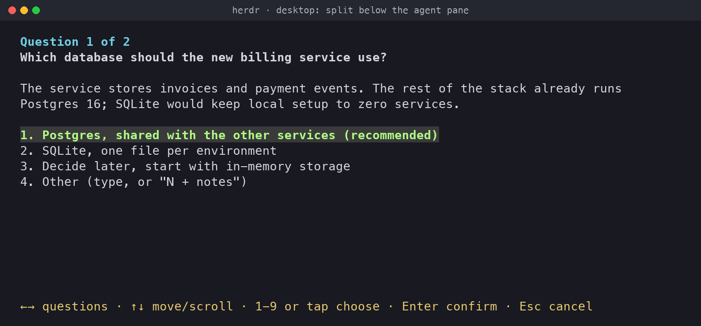
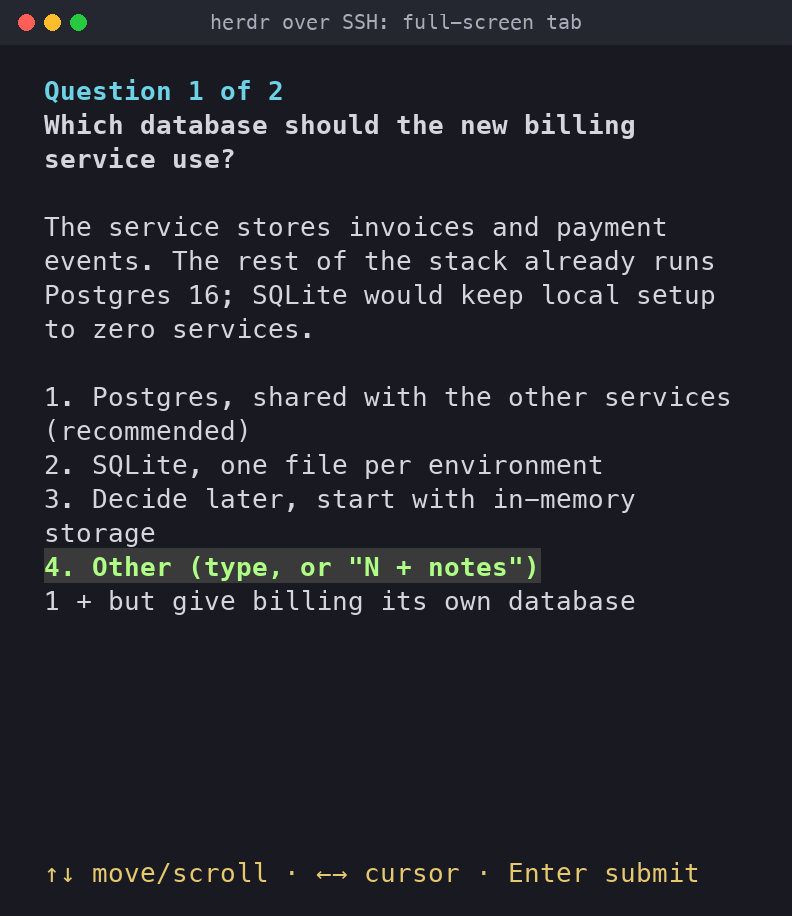
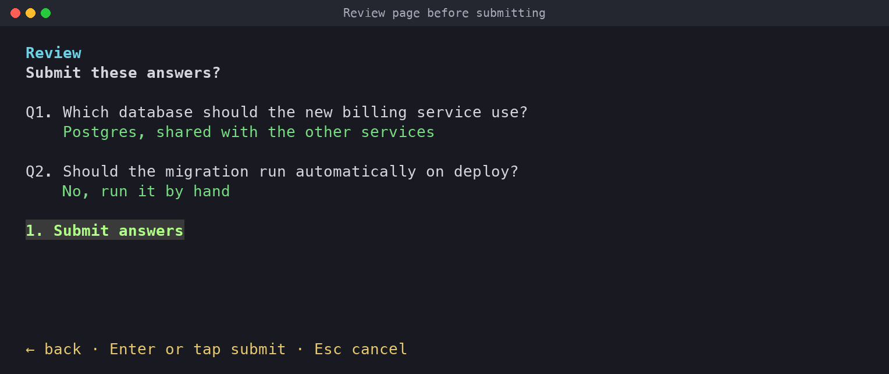

# herdr-ask-user

An agent skill that asks you numbered multiple-choice questions in a herdr pane and returns your answers as JSON.

Prime Agent 0.10 has no tool for asking the user a question, and it cannot load the TypeScript `ask_user` extension. This skill fills that gap for Prime Agent, Codex and Cursor running inside [herdr](https://herdr.dev). Claude Code is left out: it has its own AskUserQuestion tool, and the script refuses to run there.

## 📦 Requirements

- [herdr](https://herdr.dev/tui/docs/install/)
- [Node.js](https://nodejs.org/en/download)

## 🔧 Installation

1. Install the skill for Codex and Cursor:

   ```bash
   npx skills add mifkata/herdr-ask-user -g -a codex cursor
   ```

2. Link it for Prime Agent, which the skills CLI does not support:

   ```bash
   mkdir -p ~/.prime/agent/skills
   ln -s ~/.agents/skills/herdr-ask-user ~/.prime/agent/skills/herdr-ask-user
   ```

3. Check that it is installed:

   ```bash
   npx skills list -g
   ```

   The list shows `herdr-ask-user`. Start a new agent session to load it; Prime Agent's `/reload` does not pick up new skills.

To update the skill later, run:

```bash
npx skills update herdr-ask-user -g
```

## 🧭 How it works

The agent writes its questions as JSON and runs [`herdr-ask-user/scripts/ask-user.mjs`](herdr-ask-user/scripts/ask-user.mjs). The script opens the questions in herdr, waits for your answers, closes what it opened and prints the answers. The agent-side contract is in [`herdr-ask-user/SKILL.md`](herdr-ask-user/SKILL.md).

Where the questions open depends on the herdr client you typed in last:

- Desktop: a split pane below the agent's pane, in the same tab. It takes 40% of the pane's height and grows to fit long questions, up to 75%.
- SSH: a full-screen tab, sized to your screen.
- Another workspace: your view stays where it is, and herdr shows a "Question waiting" notification.





With more than one question, a review page lists every answer before you submit.



| Key | Action |
| --- | --- |
| ↑ ↓, or `j` `k` outside Other | Move between options; past the first or last option, scroll |
| PgUp PgDn | Scroll one screen |
| Mouse wheel | Scroll three lines |
| 1–9, tap or click | Choose an option |
| Enter | Confirm the option, or submit the Other answer |
| ← → | Previous or next question; move the cursor while typing in Other |
| `N + notes` in Other | Choose option N and add notes |
| Esc | Cancel; ignored while typing in Other |
| Ctrl+C | Cancel |
